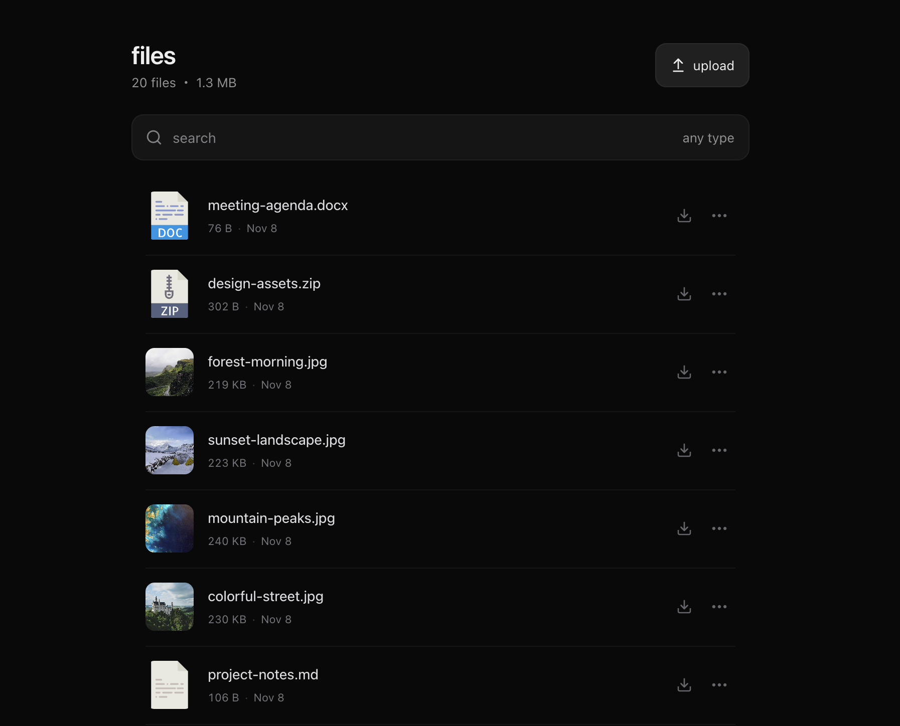
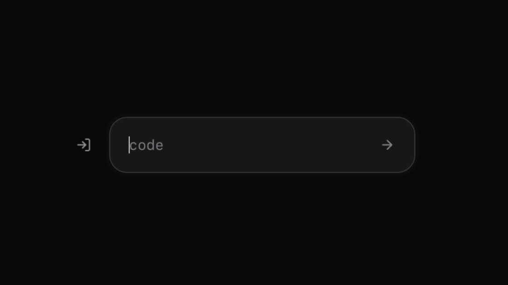

<h1 align="center">drop</h1>

<p align="center">share files from your private telegram channel with short links anyone can open in a browser.</p>

## share a file

1. **add a file.** post it to your private telegram channel or sign in to drop and drag it onto the page. files already in the channel show up in your dashboard too.
2. **copy the link.** choose **share link** from the file’s menu. to use a readable ending like `/project-notes`, choose **edit code** first.
3. **send it.** anyone with the link or code can download the file without joining your channel or signing in.



## download a shared file

open the share link or enter the code on the home page, then click **download**.



## self-hosting

the react dashboard talks to a hono server. sqlite tracks files and share codes. the server stages uploads on disk, sends them to the private telegram channel, and streams downloads back from telegram.

### run locally

1. install **node.js 24 lts** (24.11 or later) and **ffmpeg** with `ffprobe`.
2. set your private channel’s peer id (including the `-100` prefix) in [`server/telegram-chat.ts`](server/telegram-chat.ts). use a telegram account with permission to post, edit, and delete messages there.
3. get your telegram api credentials. [telegram api settings](https://my.telegram.org/apps)

run these commands in order from the repository root.

```sh
npm ci
npm run setup
npm run telegram:login
npm run dev
```

setup prompts for an upload password and your api credentials. during telegram login, open the local url printed in the terminal and scan the qr code in telegram. after `npm run dev`, open [the local app](http://127.0.0.1:5173).

for disk-only development, use `STORAGE=local npm run setup` in place of `npm run setup` and skip telegram login.

for systemd, https, and backups, see the [deployment notes](docs/deployment.md).

### checks

| check           | command                                                           |
| --------------- | ----------------------------------------------------------------- |
| lint and types  | `npm run lint` and `npm run typecheck`                            |
| tests and build | `npm test` and `npm run build`                                    |
| browser tests   | `npx playwright install chromium webkit`, then `npm run test:e2e` |

## license

the project code is available under the [mit license](LICENSE).

file artwork is covered by the [upstream terms for pretty-file-icons](https://github.com/kravets-levko/pretty-file-icons#pretty-file-icons).
