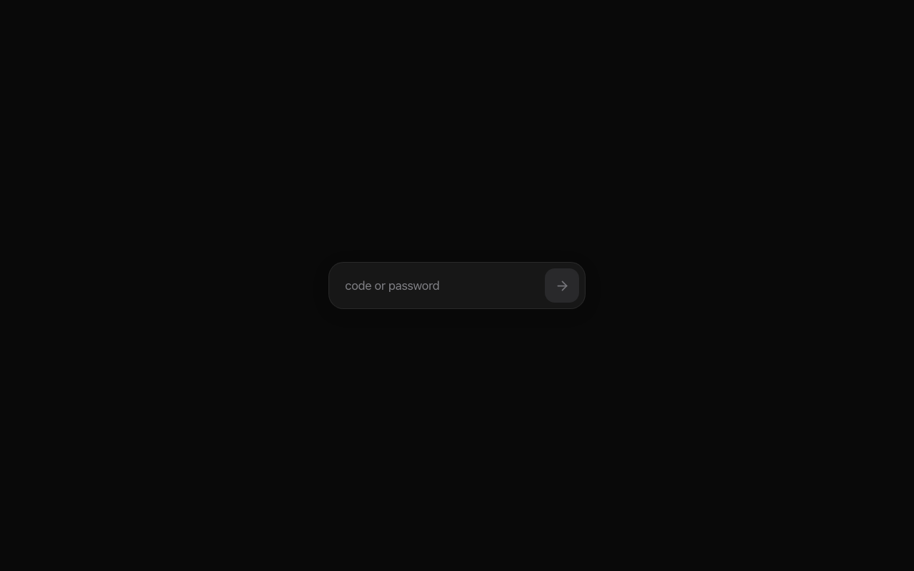

<h1 align="center">drop</h1>

<p align="center">files in. code out.</p>

<p align="center">
  <a href="https://f.mythra.pw">f.mythra.pw</a>
</p>

<p align="center">
  
</p>

enter a password to upload or a code to download. drop anywhere. click a filename to download, or its code to copy.

password protected uploads · telegram storage · saved messages sync · manual removal

### run

node.js 24 lts. get telegram api credentials from [my.telegram.org](https://my.telegram.org/apps).

```sh
npm ci
npm run setup
npm run telegram:login
npm run dev
```

### layout

```text
src/             react interface
server/          hono api, queue, sqlite, storage
shared/          file schemas and formatting
scripts/         setup and telegram login
tests/           api and browser tests
deploy/          caddy configuration
```

```sh
npm run lint
npm run typecheck
npm test
npm run build
npx playwright install chromium webkit
npm run test:e2e
```

[deployment notes](docs/deployment.md)
